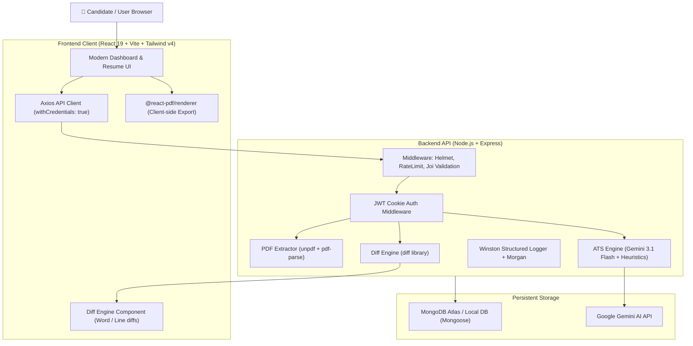

# 📄 AI Resume Checker & ATS Optimizer

[](https://github.com)
[](https://github.com)
[](http://localhost:5000/api-docs)
[](docker-compose.yml)
[](https://github.com)

A production-grade, full-stack AI Resume Optimizer that analyzes resumes against target roles, calculates real-time ATS compatibility scores across 5 core dimensions, diagnoses issues, rewrites bullet points using Google's X-Y-Z formula, computes version diffs, exports clean ATS-friendly PDFs, and tracks career progression analytics.

---

## 🚀 Key Features

* **⚡ Automated PDF Parsing Pipeline**: Uses `unpdf` and `pdf-parse` to extract structured sections (contact, summary, experience, skills, education, certifications) with fallback heuristics.
* **🎯 5-Pillar ATS Scoring Engine**: Evaluates resumes on *Keywords Matching*, *Formatting & ATS Readability*, *Business Impact*, *Section Readability*, and *Action Verbs*.
* **✨ AI Bullet Rewriting (Google X-Y-Z Formula)**: Rewrites weak bullets (*"Accomplished [X] as measured by [Y], by doing [Z]"*) with quantified metrics, instantly generating new resume versions (V2, V3...).
* **🔍 Version Diffing Engine**: Inline side-by-side or unified diff comparison highlighting added and removed words or lines across resume revisions.
* **📊 Cross-Resume Analytics & Dashboard**: Aggregated KPI sparklines, score evolution trends, top recurring issues, and audit activity history.
* **🖨️ Client-Side ATS PDF Export**: High-fidelity single-column ATS compliant PDF rendering powered by `@react-pdf/renderer`.
* **🛡️ Production Hardened Security**: HTTP-only JWT cookies (`arr_token`), bcrypt password hashing, Joi request validation, Helmet HTTP headers, multi-tier rate limiting, and CORS whitelisting.
* **📖 Interactive OpenAPI / Swagger Docs**: Complete interactive documentation available at `/api-docs`.

---

## 🏗️ System Architecture



---

## 🛠️ Technology Stack

| Layer | Technologies |
|---|---|
| **Frontend** | React 19, Vite 8, Tailwind CSS v4, Framer Motion, TanStack Query v5, Recharts, Lucide Icons, `@react-pdf/renderer` |
| **Backend** | Node.js (CommonJS), Express 4, Mongoose 8, JWT, bcryptjs, Multer |
| **AI / NLP** | Google Gemini Generative AI (`gemini-3.1-flash-lite`, `gemini-flash-latest`), Heuristic ATS Fallback Engine |
| **Validation & Docs** | Joi, Swagger JSDoc, Swagger UI Express (OpenAPI 3.0) |
| **Observability** | Winston Logger, Morgan HTTP Logging |
| **Testing** | Jest, Supertest (25 passing automated tests) |
| **DevOps / Deploy** | Docker, Docker Compose, Nginx Alpine, Multi-stage builds |

---

## 📚 API Endpoints Overview

| Method | Endpoint | Description | Auth Required |
|---|---|---|---|
| `GET` | `/api/health` | Service health status and database connectivity | No |
| `GET` | `/api-docs` | Interactive Swagger UI API documentation | No |
| `POST` | `/api/auth/register` | Register candidate account (Joi validated) | No |
| `POST` | `/api/auth/login` | Authenticate and issue HTTP-only JWT cookie | No |
| `POST` | `/api/auth/logout` | Clear auth cookie | Yes |
| `GET` | `/api/auth/me` | Fetch authenticated user profile | Yes |
| `PATCH` | `/api/auth/profile` | Update user display name | Yes |
| `PATCH` | `/api/auth/password` | Change user password | Yes |
| `GET` | `/api/resumes` | List candidate resumes with scores | Yes |
| `POST` | `/api/resumes` | Upload PDF, parse sections & create V1 | Yes |
| `GET` | `/api/resumes/:id` | Resume detail with all versions | Yes |
| `GET` | `/api/resumes/:id/versions/:vId` | Fetch full parsed version data | Yes |
| `POST` | `/api/resumes/:id/analyze` | Run ATS scoring & bullet diagnostics | Yes |
| `POST` | `/api/resumes/:id/rewrite` | Apply bullet rewrites and spawn next version | Yes |
| `GET` | `/api/resumes/:id/diff` | Compute inline word/line diff between versions | Yes |
| `DELETE` | `/api/resumes/:id` | Cascading delete of resume and all artifacts | Yes |
| `GET` | `/api/dashboard` | Aggregated KPI metrics, sparklines & activity | Yes |
| `GET` | `/api/insights` | Cross-resume analytics and score trends | Yes |
| `GET` | `/api/versions` | List all version iterations across resumes | Yes |
| `GET` | `/api/history` | Audit log of all candidate actions | Yes |

---

## 🧪 Automated Test Suite

The project includes an automated test suite verifying auth flows, PDF extraction, Joi validation, ATS scoring algorithms, diff calculations, and cascading deletions:

```bash
cd backend
npm test
```

### Test Results
```text
PASS tests/health.test.js
PASS tests/auth.test.js
PASS tests/resumes.test.js
PASS tests/scoring.test.js
PASS tests/diff.test.js

Test Suites: 5 passed, 5 total
Tests:       25 passed, 25 total
Snapshots:   0 total
Time:        10.5 s
```

---

## 🏃 Local Development Setup

### 1. Prerequisites
* Node.js v18+ 
* MongoDB Atlas connection string (or local MongoDB on port 27017)
* Google Gemini API Key

### 2. Backend Setup
```bash
cd backend
npm install
cp .env.example .env
# Fill in your MONGO_URI, JWT_SECRET, and GEMINI_API_KEY in .env
npm run dev
```
*Backend runs on `http://localhost:5000`*  
*Swagger Documentation available at `http://localhost:5000/api-docs`*

### 3. Frontend Setup
```bash
cd frontend
npm install
npm run dev
```
*Frontend runs on `http://localhost:5173` (with Vite proxy forwarding `/api` to port 5000)*

---

## 🐳 Docker Deployment

To spin up the entire stack (MongoDB, Backend, and Nginx-served Frontend) with a single command:

```bash
docker-compose up --build
```

* **Frontend**: `http://localhost`
* **Backend API**: `http://localhost:5000`
* **Swagger API Docs**: `http://localhost:5000/api-docs`

---

## 🔒 Security Hardening

* **Helmet HTTP Headers**: Enforces secure HTTP headers.
* **Joi Schema Validation**: All request bodies are strictly typed and sanitized before controller execution.
* **Tiered Rate Limiting**: Dedicated rate limiters for Authentication (`40 req / 15m`), AI Scoring (`50 req / 15m`), and File Uploads (`30 req / 15m`).
* **Zero Trust Data Isolation**: Multi-tenant database queries enforce `userId: req.user._id` across every resume and version lookup.
* **HTTP-Only Cookies**: Prevents client-side XSS access to authentication tokens.

